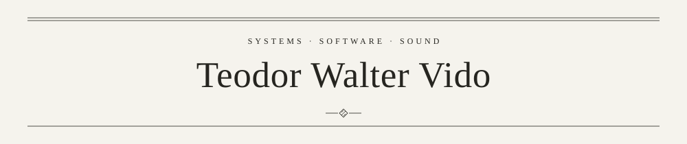
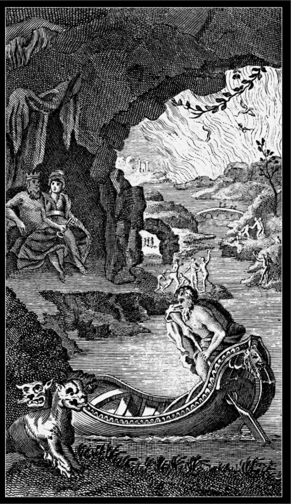

  

  

 

  I build software, explore systems, and work with sound. 
  Interested in how things work — and what they could become.

  <a href="https://teodorwaltervido.com">Selected work</a> &nbsp; / &nbsp;
  <a href="mailto:hi@teodorwaltervido.com">Correspondence</a>

 

### Selected projects

[Shadow-Twin Transformer](https://github.com/baiehclaca/shadow-twin-transformer) — experiments with coupled transformer streams. 
[open402](https://github.com/baiehclaca/open402) — a protocol and SDK for HTTP payments. 
[Service](https://github.com/baiehclaca/service) — an MCP hub and notification gateway. 
[Caret Translate](https://github.com/baiehclaca/caret-translate) — translation at the cursor on macOS.

Further work

 

[Stratum](https://github.com/baiehclaca/Stratum) ·
[Singular Company](https://github.com/singularqx) ·
[Veil Browser](https://github.com/veilbrowser/veil) ·
[OpenClaw War-Room](https://github.com/baiehclaca/openclaw-warroom) ·
[Gula-Gug](https://github.com/baiehclaca/GULA-GUG) ·
[Knono](https://knono.info/) ·
[Frontpage](https://frontpage.social/) ·
[86chan](https://86chan.online/)

 

---

Slovakia &nbsp; · &nbsp; <a href="https://twitter.com/teodorwalterv">Elsewhere</a>

